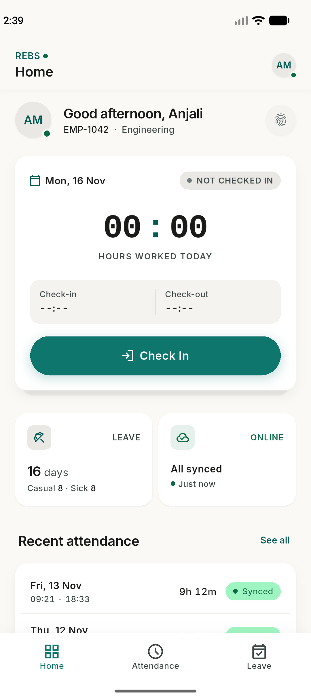
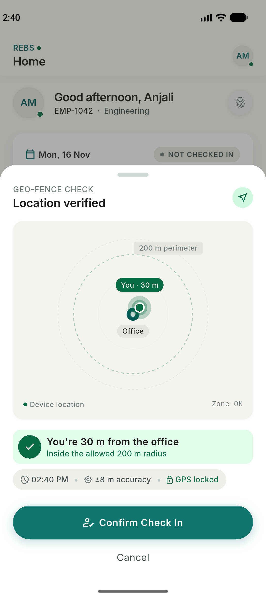
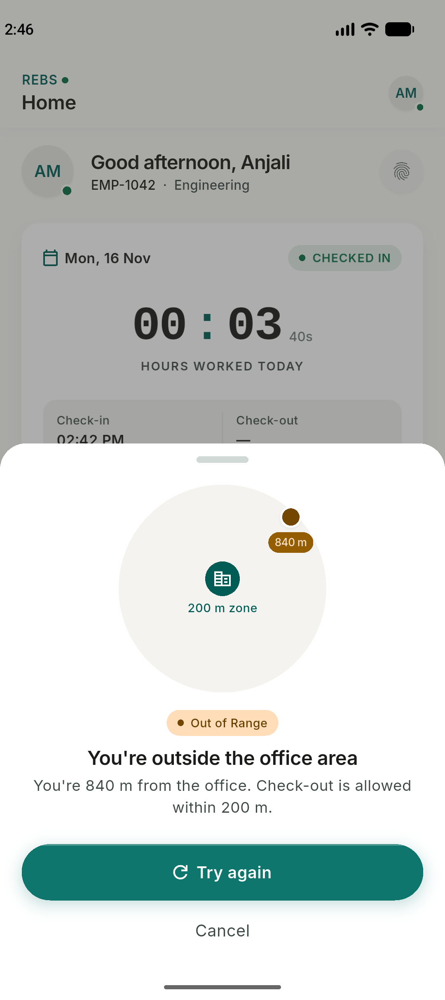
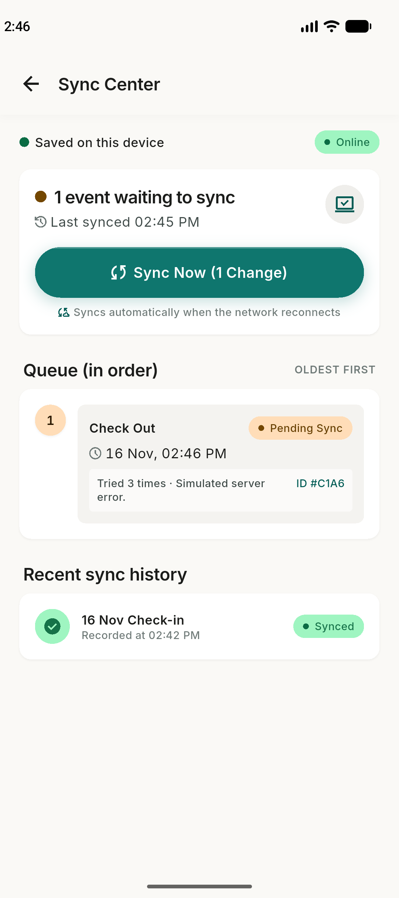
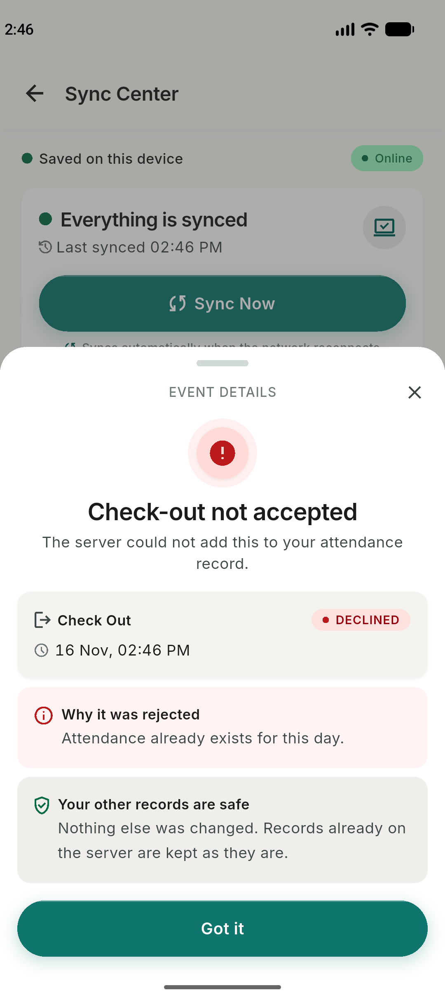
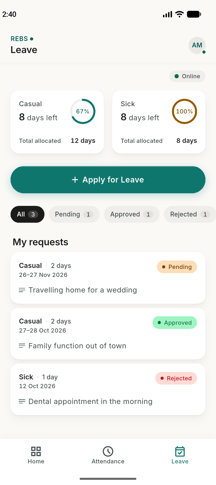
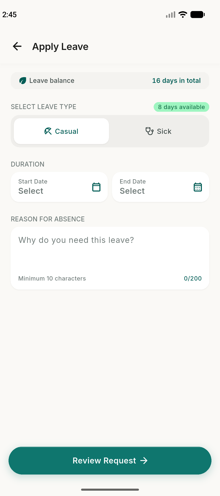
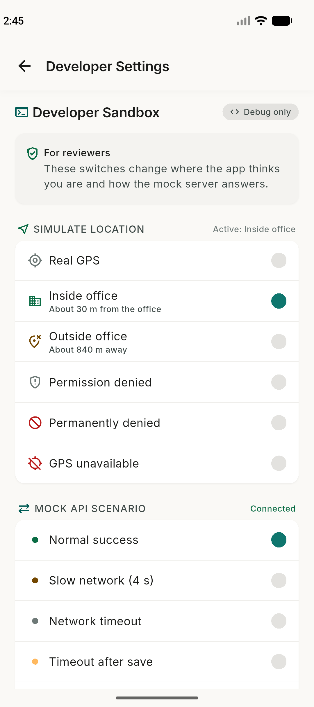

# REBS HRMS — Offline-Capable Employee Workspace

A Flutter take-home: one employee can check in and out (geofenced, works
offline), see their dashboard, and request leave. The focus is on
**correctness and reliability of sync**, not on visual flourish.

## Overview

| Area | What it does |
| --- | --- |
| Home | Employee, today's status, live working timer, check-in / check-out, leave balance, latest 5 attendance days, sync status, offline banner, pull-to-refresh |
| Attendance | Geofenced check-in / check-out with a "verify location, then confirm" step; written to a local outbox first and synced in the background; monthly history with a Pending / Synced / Rejected chip per day |
| Leave | Balances, request list with filters, validated form (dates, balance, overlap, reason) and a review step; sending needs a connection; the list is cached for offline viewing |
| Sync | Outbox in Hive, strict ordering, idempotent retries, rejection handling, backoff; a Sync Center screen with "Sync Now" |
| Mock API | Separate Dart project with full server-side re-validation and switchable failure scenarios |

Stack: Flutter 3.38 / Dart 3.10, GetX, Dio, Hive, geolocator,
connectivity_plus, uuid, intl, timezone, flutter_svg. Tests: flutter_test,
mocktail. Mock server: shelf + shelf_router.

## Screenshots

Taken on an Android emulator against the mock server. "Sync Center" was
captured with the `server_error` scenario active, so the check-out is
waiting in the outbox; "Rejected event" with `duplicate_attendance`.

> **These images are out of date.** They were taken before the colour
> changed from green to blue and before the system font replaced Inter.
> The layout is the same. Retake them before submitting.

| Home | Location check | Out of range | Sync Center (pending) |
| --- | --- | --- | --- |
|  |  |  |  |

| Rejected event | Leave | Leave form | Developer Settings |
| --- | --- | --- | --- |
|  |  |  |  |

## UI and the Figma design

The UI implements the 13 screens of the Figma file (splash, home and its
loading state, location check, location problems, check-in confirmation,
attendance history, sync center, rejected event, leave overview, leave
form, leave review, developer settings).

- **Tokens**: colours, type scale and shadows from Figma live in
  `lib/core/theme/`. Widgets use tokens only, never raw values.
- **Icons**: the Figma SVGs are in `assets/icons/` and drawn by
  `flutter_svg` through one `AppIcon` widget. `flutter_svg` was added
  because Flutter cannot render SVG without it.
- **Fonts**: the device's system font (Roboto on Android, San Francisco on
  iOS) is used instead of the design's Inter, on request. Sizes, weights
  and spacing still follow the Figma type scale.
- **Blue instead of green**: on request, the design's teal brand colour
  and green "success" colour are blue in the app. Everything else follows
  the Figma tokens.
- **Light theme only**: the design defines no dark theme, so the app does
  not offer one.

Where the app deliberately differs from the Figma file, because the design
shows data the app does not have or claims it cannot make:

| Figma shows | App shows | Why |
| --- | --- | --- |
| Profile photo | Initials avatar | The API has no photo |
| "Enterprise End-to-End Encrypted", "Encrypted Cache 38.4 KB", "Network Ping 42ms", "Biometric verify" | Omitted | Not true of this app |
| Splash progress "39%" | Animated bar, no number | Nothing is being measured |
| Shift window, lunch time, map preview, office photo, reporting manager | Omitted | No such data in the API |
| "Submitting will supersede it" (overlapping leave) | "Choose different dates" style warning | Overlaps are rejected by the rules |
| Header title "Apply Leave" on sync, location and developer screens | The screen's real title | A leftover in the design |
| Developer Settings opened from a fingerprint button on Home; three bottom tabs | A fourth "Settings" tab in the bottom bar; no button on Home | Requested change, and easier for reviewers to find |
| Designer "state preview" switchers and toggles | Omitted | Design-time controls, not product features |
| Logo image | "REBS" set in type | The logo layer in the file is empty |
| Location problems as a full page | Shown inside the location sheet | One flow, no extra navigation |

## Architecture

Clean Architecture, feature-first. Dependencies point inwards only.

```
 presentation                 domain (pure Dart)              data
┌──────────────────┐      ┌───────────────────────┐      ┌─────────────────────┐
│ View (widgets)   │      │ Entities              │      │ Models              │
│   │ observes     │      │ Rules / Validators    │      │  fromJson / toDb    │
│   ▼              │      │ Use cases             │      │ Remote data source  │
│ Controller ──────┼─────▶│   call()              │      │   (Dio)             │
│  (GetxController)│      │ Repository interfaces │◀─────┼─ Repository impls   │
│ ViewState<T>     │      │ Service interfaces    │      │ Local data source   │
└──────────────────┘      │ (Clock, NetworkInfo,  │      │   (Hive)            │
                          │  LocationService)     │      │ Location services   │
                          └───────────────────────┘      └─────────────────────┘

 Check-in, online or offline — one path:

 tap ─▶ AttendanceController ─▶ RecordAttendanceEvent
                                   1. rules (server cache + outbox)
                                   2. location  (fix reused from the
                                   3. geofence   "verify location" sheet)
                                   4. INSERT outbox_events (PENDING) ──▶ UI flips
                                                │                        "Pending Sync"
                                                ▼
                     SyncService ─▶ ProcessOutbox ─▶ POST /attendance/events
                     (when)         (how: seq order,   Idempotency-Key: <event_id>
                                     one at a time)
```

Rules that are enforced by structure, not by convention:

- Widgets never touch Dio or the database. View → Controller → Use case →
  Repository → Data source.
- The domain layer imports no Flutter, GetX, Dio or Hive.
- No logic in `build()`. Controllers expose finished strings; every screen
  has a plain "content" widget (data in, callbacks out) that is tested
  without any controller.
- Every screen state is a sealed `ViewState<T>`:
  `ViewLoading | ViewEmpty | ViewError | ViewData(value, isStale, isOffline)`.
- Errors are values: data sources throw exceptions, repositories return
  `Result<T>` (`Success | Fail`) carrying a sealed `Failure`.
- `Clock`, `NetworkInfo` and `LocationService` are interfaces, so tests
  control time, connectivity and position.
- All user-facing text is in `lib/core/strings/app_strings.dart`.

## Local storage: Hive

All local data is in Hive, a key-value store that keeps its data in files
in the app's private folder. Values are plain maps and lists (the same
shape as the API's JSON), so no generated adapters or build step are
needed. Two boxes:

| Box | Contents |
| --- | --- |
| `cache` | One entry each for the employee, attendance history, leave balances and leave requests. Each entry is `{fetched_at, data}`. |
| `outbox_events` | Check-ins and check-outs waiting to reach the server. The key is Hive's auto-incrementing number, used as the event's `seq` (the sending order). |

**Why Hive:** small, fast, pure Dart, and needs no schema or SQL for data
that is only ever read whole.

**What Hive does not give, and how that is handled**

- **No transactions.** Each cache entry holds its data and its timestamp
  together and is replaced with a single write, so the two cannot get out
  of step.
- **No unique indexes.** The "one live check-in per day" and "one event
  per `event_id`" rules are enforced in `OutboxLocalDataSource.insert`
  (see Sync design below) and covered by tests.
- **No queries.** The outbox is filtered in memory. It holds a handful of
  events, so this is not a cost.
- **No migrations.** A schema version is stored as an entry and upgrades
  would be applied in `AppDatabase._migrate`.

`hive` 2.2.3 is the original package and is no longer actively developed;
`hive_ce` is the maintained community fork with the same API, should a
switch ever be wanted.

## Why GetX

**Chosen because**

- Low boilerplate: reactive state, dependency injection and routing from
  one small dependency, which suits an ~8-hour scope.
- `GetxService` gives a natural home for a long-lived `SyncService`.
- Bindings tie a controller's lifetime to its route.

**Costs, stated honestly**

- It is a global service locator: dependencies can be hidden behind
  `Get.find` anywhere.
- It is less explicit than Bloc: there are no named events or state
  transitions to read or log.
- It encourages putting everything in controllers.

**How those are contained here**

- `Get.find` appears only in the composition root (`InitialBinding`) and
  the feature bindings. Controllers, use cases, repositories and data
  sources all use **constructor injection**, so each can be built in a test
  with no GetX at all — and the tests do exactly that.
- Business rules live in pure-Dart classes (`AttendanceRules`,
  `LeaveValidator`, `ProcessOutbox`), not in controllers.
- State is a sealed `ViewState<T>`, so the "what can the screen be showing"
  question still has an explicit, compiler-checked answer.

Swapping GetX for another solution would mean rewriting the controllers
and bindings only; domain and data would not change.

## Folder structure

```
lib/
  main.dart
  app/
    app.dart                         root widget
    bindings/initial_binding.dart    composition root (all wiring)
    routes/                          route names + pages
    config/app_config.dart           dart-defines: base URL, office, timezone
    shell/                           header + bottom-navigation frame
    splash/                          launch screen
  core/
    error/        failures.dart (sealed), exceptions.dart
    network/      dio_client, api_log_interceptor, error_mapper,
                  cached_fetch, network_info (+ connectivity impl)
    database/     app_database.dart (Hive boxes: cache + outbox)
    utils/        result, view_state, cached, clock, geo_utils, formatters
    strings/      app_strings.dart
    theme/        colors, text, shadows, theme (Figma tokens)
    widgets/      AppIcon, AppCard, AppHeader, AppSheet, PressableScale,
                  TiltCard, PrimaryButton, StatusChip, SectionHeader,
                  SkeletonBox, EmptyView, ErrorView, OfflineBanner,
                  AppDatePickerField, AppTextField, StateBuilder,
                  ContentWidth, AppMessenger, NoticeSheet
  features/
    employee/     data/ domain/
    attendance/   data/ domain/ presentation/
    leave/        data/ domain/ presentation/
    sync/         data/ domain/ presentation/
    dashboard/    presentation/
    developer/    data/ domain/ presentation/   (reviewer tools)
assets/
  icons/          SVG icons exported from Figma
mock_server/      separate Dart project (shelf)
test/             unit, widget and live-server tests
```

## Setup

Requirements: Flutter 3.38+ (Dart 3.10+).

**Live mock API (no setup)**

A copy of `mock_server/` is hosted at
**https://rebs-hrms-mock-api.onrender.com** and the app uses it by default,
so the debug APK works on any phone without running anything locally.

- It runs on a free plan that sleeps after about 15 minutes without
  requests. The first request after that can take up to a minute, which is
  longer than the app's 8 s timeout: the app opens in offline mode, and a
  pull-to-refresh a little later loads the data. Opening
  https://rebs-hrms-mock-api.onrender.com/employee/me in a browser first
  wakes it up.
- Data is kept in memory, so it is cleared whenever the server sleeps or
  restarts, and it is shared by everyone using the address.

**1. Start the mock server locally (optional)**

```bash
cd mock_server
dart pub get
dart run bin/server.dart            # http://localhost:8080  (--port 9090 to change)
```

It prints every request and response, so you can watch the app talk to it.

**2. Run the app**

```bash
flutter pub get
flutter run --dart-define=MOCK_LOCATION=inside                                             # live server
flutter run --dart-define=MOCK_LOCATION=inside --dart-define=API_BASE_URL=http://10.0.2.2:8080   # local server
```

| dart-define | Default | Meaning |
| --- | --- | --- |
| `API_BASE_URL` | `https://rebs-hrms-mock-api.onrender.com` | Server address. The default is the hosted mock API. For a server on your own computer use `http://10.0.2.2:8080` on the Android emulator, your computer's LAN IP on a real phone (e.g. `http://192.168.1.20:8080`), or `http://localhost:8080` on the iOS simulator. |
| `MOCK_LOCATION` | _(empty = real GPS)_ | `inside`, `outside`, `denied`, `denied_forever`, `unavailable` |

In debug builds every API request and response is printed to the console
with an `[API]` prefix.

**3. Build a debug APK**

```bash
flutter build apk --debug --dart-define=MOCK_LOCATION=inside
# -> build/app/outputs/flutter-apk/app-debug.apk
```

**4. Tests**

```bash
flutter test                         # app: unit + widget
cd mock_server && dart test          # server handlers

# optional: the app's real data layer against the real server
cd mock_server && dart run bin/server.dart --port 8090
$env:MOCK_SERVER_URL="http://localhost:8090"; flutter test test/integration   # PowerShell
MOCK_SERVER_URL=http://localhost:8090 flutter test test/integration           # bash
```

## Simulating location

The office is at 9.9312, 76.2673 (Kochi) with a 200 m radius, so real GPS
will normally be "outside". Three ways to test:

1. **At launch** — `--dart-define=MOCK_LOCATION=<mode>`
2. **At runtime** — open the **Settings** tab (the fourth item in the
   bottom navigation bar), which is the Developer Settings screen. It is
   available in debug and release builds, because this is a test
   submission. Pick Real GPS, Inside office or Outside office under
   "Simulate location"; it applies to the next check, with no restart.
   The three failure modes (`denied`, `denied_forever`, `unavailable`)
   are available at launch only.

3. **Move the office to you** — on the same Settings tab, under "Office
   parameters", **Use my current location** sets the office to the
   phone's real GPS position, and **Enter coordinates** takes a latitude
   and longitude. After that, Real GPS is "inside" wherever you are. The
   change is made on the mock server (`POST /__mock/office`) and read back
   through `/employee/me`, so the app's check and the server's re-check
   use the same office. It needs a connection, it affects everyone using
   that server, and the reset button puts the office back.

| Mode | Behaviour | What the UI shows |
| --- | --- | --- |
| _(real GPS)_ | Uses the device | Depends on where you are |
| `inside` | ~30 m from the office | Check-in succeeds |
| `outside` | ~840 m from the office | "You're 840 m from the office. Check-in is allowed within 200 m." |
| `denied` | Permission denied | Message + **Allow location** (asks again) |
| `denied_forever` | Permission blocked | Message + **Open app settings** |
| `unavailable` | No fix | Message + **Try again** |

With real GPS, location switched off shows **Turn on location**, which
opens the system location settings.

Design: the domain depends on a `LocationService` interface.
`DeviceLocationService` (geolocator) and `MockLocationService` implement
it; `SwitchableLocationService` forwards to one or the other.

## Mock scenarios

Scenarios are switched from a terminal (the app's Settings tab only
resets the server and clears the local data). For the hosted server, use
`https://rebs-hrms-mock-api.onrender.com` in place of `http://localhost:8080`.

```bash
curl -X POST http://localhost:8080/__mock/scenario -H "content-type: application/json" -d '{"name":"timeout_after_commit"}'
curl -X POST http://localhost:8080/__mock/reset      # clear all data + success
```

PowerShell:

```powershell
Invoke-RestMethod -Method Post -Uri http://localhost:8080/__mock/scenario -ContentType application/json -Body '{"name":"timeout_after_commit"}'
```

Or per request with the header `X-Mock-Scenario: <name>` (wins over the
global setting). A scenario stays active until changed, so every failure
is repeatable.

| Scenario | Server behaviour | What to observe in the app |
| --- | --- | --- |
| `success` | Normal, full validation | Events go Pending → Synced |
| `slow` | Answers after 4 s | Skeletons / spinners, then success |
| `timeout` | Hangs 15 s, saves nothing | Event stays Pending, retried with backoff |
| `timeout_after_commit` | **Saves**, then hangs 15 s | Event stays Pending; after switching back to `success` the retry is answered with the original record — still one record on the server |
| `server_error` | 500 | Event stays Pending, retried |
| `duplicate_attendance` | 409 `ATTENDANCE_ALREADY_EXISTS` on attendance POST | Event becomes Rejected; tap the chip for the reason |
| `leave_validation` | 422 with field errors on leave POST | Errors appear under the form fields |

`slow`, `timeout` and `server_error` affect every API call;
`timeout_after_commit` affects POSTs only. Control endpoints
(`/__mock/*`) are never affected, so a scenario can always be turned off.

Error body: `{"code":"STRING","message":"human readable","field":"optional"}`.
Leave validation adds `"errors":[...]` with every field error.

## Offline behaviour

The app stays usable when the server cannot be reached, including on a
first launch with nothing saved.

| Situation | What the user sees |
| --- | --- |
| Data was loaded before, server unreachable now | The saved Home, attendance history and leave list, with a "Working offline · Showing saved data · last updated …" banner |
| First launch, server unreachable | Home still opens: no profile yet, but today's card and Check In work, with a "Could not reach the server" banner |
| Check-in / check-out while offline | Saved on the device, shown at once as "Pending Sync", sent automatically later |
| "Apply for Leave" while offline | A bottom sheet: "You're offline", leave requests need a connection, with Try again. Leave is never queued |
| "Sync Now" fails | A bottom sheet with the reason and the reassurance that nothing was lost |
| The server answers with an error (e.g. 500) and nothing is saved | The error state with a Try again button |
| Connection returns, or a pending event syncs | The screens refresh by themselves |

A network problem or a timeout counts as "offline"; only a real answer
from the server that is an error produces the error state.

## Sync design

**Outbox.** Every check-in / check-out is inserted into `outbox_events`
(status `PENDING`) and only then is a sync attempted. Online and offline
use the same code path, so the offline path is exercised on every use
rather than only when the network happens to be down. "Today's state" is
never stored separately: it is always derived from the server cache merged
with the outbox, so the two cannot disagree. The UI flips immediately and
shows a "Pending Sync" chip.

**Duplicate protection, three layers.**
1. Controller `isSubmitting` lock (the button shows a spinner and ignores taps).
2. Domain: rules are checked against server cache **plus PENDING outbox
   events**, and the use case refuses a second call while one is in flight.
3. Storage: the outbox data source refuses a second live `CHECK_IN` or
   `CHECK_OUT` for the same working day (and a repeated `event_id`).
   Hive has no unique indexes, so this is a check-then-write in code. It
   cannot race with itself: there is no `await` between the check and
   the write, and Hive updates its in-memory copy immediately.

**Ordering.** `ProcessOutbox` sends events strictly by `seq`, one at a
time. A flag set before the first `await` acts as a mutex against
concurrent runs. A temporary failure stops the whole run, so a `CHECK_OUT`
can never reach the server before its `CHECK_IN`.

**Outcomes per event.**

| Server answer | Result |
| --- | --- |
| 2xx | `SYNCED`, `server_record_id` stored |
| 409 duplicate of the same `event_id` | `SYNCED` (the server already has it) |
| Other 4xx (e.g. `ATTENDANCE_ALREADY_EXISTS`, outside geofence) | `REJECTED` with the reason; continue with the next event |
| Timeout, network error, 5xx | back to `PENDING`, `attempts + 1`, **stop the run** |

**Idempotency.** Each event gets a UUID v4 `event_id` when it is created.
It is sent as the `Idempotency-Key` header and in the body, and it never
changes across retries. The server checks it **before** its business
rules, so a retry returns the original record instead of
"attendance already exists".

**Timeout handling.** After a timeout the client cannot know whether the
server saved the event. It does not need to: the event stays `PENDING` and
is re-sent with the same id. If the server had saved it, it replays the
original record; if not, it processes it now. Either way there is exactly
one record. An event left in `SYNCING` by a crash is treated as unsent and
handled the same way.

**Rejection cascade.** If a `CHECK_IN` is rejected, the unsent `CHECK_OUT`
for the same working day is rejected too ("Check-in was rejected") without
being sent — it could never succeed. Other days are unaffected.

**Triggers** (`SyncService`, a permanent `GetxService`): app start;
connectivity restored (debounced 2 s); "Sync Now"; right after an event is
created; and a retry timer with exponential backoff (2 s, 4 s, 8 s … max
60 s) that pauses while offline.

**After a sync** the attendance cache is refreshed from the server.

**Persistence.** The outbox lives in a Hive box on disk, so pending events
survive an app restart. Syncing while the app is terminated is out of
scope (see Limitations).

## What the server must re-validate

The client checks are for fast feedback only. The mock server repeats all
of them, and a real backend must too:

- **Idempotency** by `event_id`, and that the `Idempotency-Key` header matches it
- **One check-in per working day**; check-out only after a check-in; one check-out
- **Ordering**: check-out later than check-in
- **Working day**: derived from `occurred_at` in the company timezone; the
  client's `work_date` only has to agree
- **Geofence**: distance from the office recomputed from lat/lng
- **Timestamp sanity**: not in the future (2 min skew allowed), not older than 7 days
- **Leave**: valid type, start not in the past, end ≥ start, reason ≥ 10
  non-whitespace characters, days ≤ available balance, no overlap with a
  pending or approved request

In addition, a real backend would need authentication and would have to
treat device GPS and device clocks as untrusted input (see Limitations).

## Assumptions

- Company timezone `Asia/Kolkata`; office at 9.9312, 76.2673, radius 200 m.
  The office from `/employee/me` is used once fetched; the config value is
  the fallback. The working-day boundary uses the config timezone.
- One working session per day, no overnight shifts. A check-in left open
  cannot be closed the next day.
- The geofence applies to check-out as well as check-in.
- Events older than 7 days are refused by the server.
- Leave days are inclusive calendar days (weekends and holidays count).
  Pending requests hold balance: available = total − approved − pending.
- A retried `event_id` is answered with 200 and the original record. The
  client also accepts a 409 duplicate as "synced".
- JSON fields named in the brief are verbatim (`event_id`,
  `radiusMeters`); the rest are snake_case.
- Times are shown in the company timezone.
- Single preconfigured employee, no login.

## Completed features

- Dashboard with all listed content, skeleton loading, error with retry,
  offline banner with last-updated time, pull-to-refresh, live work timer
- Attendance rules in the domain layer, company-timezone day boundary,
  three-layer duplicate protection, GPS capture, geofence with a friendly
  message, a distinct message and action per location problem
- Location simulation via dart-define and the in-app Developer Settings
- Hive cache for employee, attendance, leave balance and leave requests
- Outbox sync: ordering, mutex, idempotency, rejection cascade, backoff,
  all triggers, per-event status chips with rejection reasons
- Leave form with inline local and server validation, a review step, and
  online-only submit
- Mock server: all endpoints, re-validation, seven scenarios, reset, request log
- Works with no server at all, even on a first launch: Home opens in
  offline mode, check-in/out is saved locally, and everything syncs and
  refreshes by itself once the server answers again
- Clear messages when something cannot be done: a bottom sheet for
  "Apply for Leave" while offline, for a leave request that could not be
  sent, and for a failed "Sync Now"
- API request/response logging in debug builds
- All 13 Figma screens, including the verify-then-confirm location sheet,
  check-in confirmation, Sync Center, leave review step and in-app
  Developer Settings (location simulation, reset)
- Tablet width cap and large-font safe layouts
- Tests: 163 app tests (unit + widget), 33 server tests, 6 live-server tests

## Limitations / unfinished

- **No background sync while the app is terminated.** Sync runs only while
  the app process is alive. Doing it properly needs WorkManager (Android)
  and BGTaskScheduler (iOS).
- **Connectivity is not reachability.** `connectivity_plus` reports that
  Wi-Fi or mobile data is attached, not that the server can be reached.
  Nothing depends on it for correctness; a failed request is handled as a
  normal failure, and the app also treats itself as offline whenever its
  last refresh failed.
- **Leave submission is not idempotent.** If a leave POST times out after
  the server saved it, retrying shows an overlap error. Pull to refresh
  shows the saved request.
- **GPS and device clock are trusted for the event itself.** Mock-location
  apps and a changed clock are not detected. The server only sanity-checks
  the timestamp.
- **Synced outbox entries are never pruned.** They are tiny, but a real app
  would delete them after some days.
- **The mock server uses a fixed UTC+05:30 offset**, not a timezone
  database. Correct for India, wrong for any zone with daylight saving.
- **Developer Settings ships in release builds too.** That is deliberate
  for a test submission, so reviewers can simulate locations in any
  build. A real product would hide it from production.
- **No authentication**, and `usesCleartextTraffic` is enabled on Android
  so the plain-HTTP mock server works. Both must change for production.
- **Light theme only.** The Figma design has no dark theme.
- **The Android launcher icon and native launch screen are still the
  Flutter defaults.** The in-app splash follows the design.
- **Header and bottom bar are opaque.** The design blurs the content
  behind them; that was left out to keep scrolling cheap.
- **"Last synced" is kept in memory**, so it is empty until
  the first sync after each app start.
- **Hive enforces no constraints itself.** Uniqueness in the outbox is
  checked in code (see "Local storage: Hive"). That is safe inside one
  app process, which is all this app has.
- **English only**, although all strings are in one file.
- **iOS has not been built or run** (developed on Windows). The
  `Info.plist` location and local-network keys are set.
- Golden (pixel) tests and a full end-to-end UI test are not included.

## Time spent

_To be filled in by the author._

## AI tools disclosure

This project was built with **Claude Code (Anthropic)** as an AI pair
programmer, working from a detailed written specification by the author
(architecture, rules, sync design, UI direction, test list). The AI
generated the code and tests phase by phase. Every non-obvious decision is
explained in a code comment so the code can be explained and changed
without the tool.

_Author: adjust this section to describe your own review and changes._
